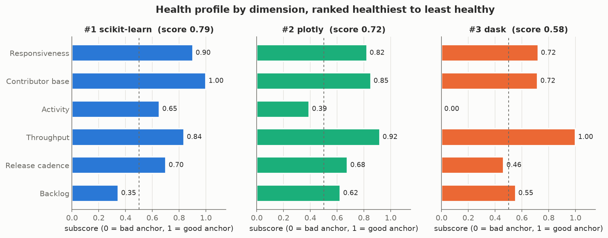
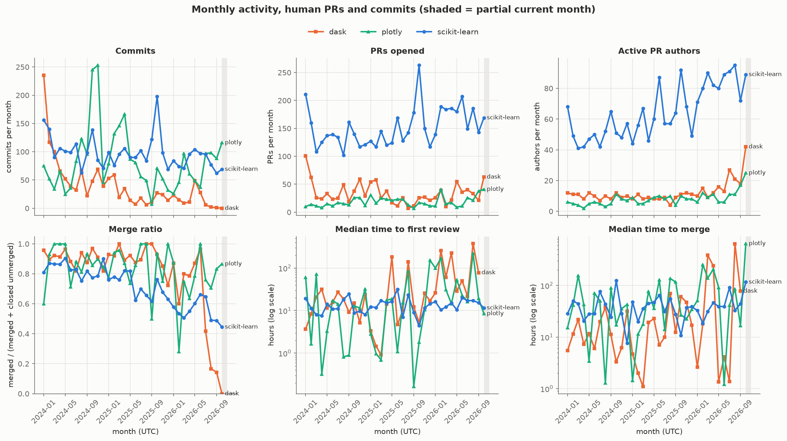
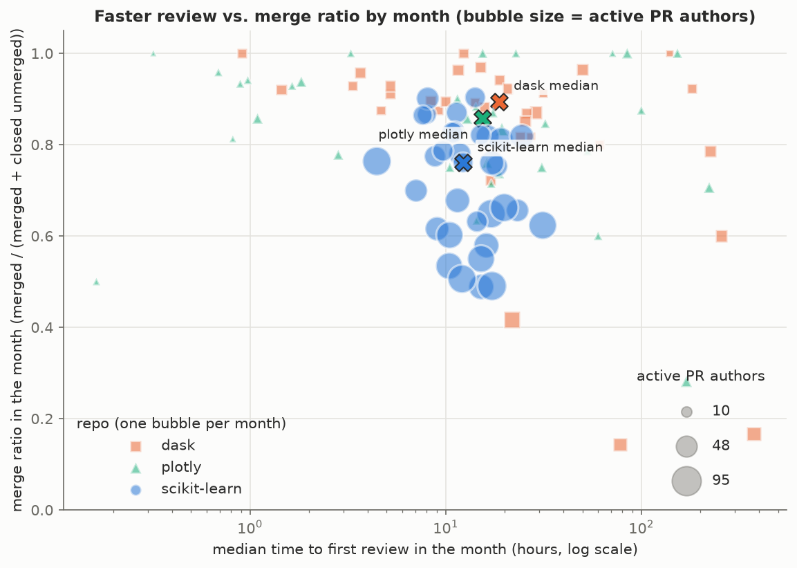

# Open Source Package Health: scikit-learn, dask, plotly

DS3022 Data Project 2, **Package Set B**: `scikit-learn/scikit-learn`, `dask/dask` and `plotly/plotly.py`.

One Prefect flow extracts the GitHub activity of the three repos from 2024-01-01 to the run time. It loads the data into DuckDB, builds and tests dbt models, validates the data, scores the health of each repo, and plots the results. The assignment brief and the rubric are in [ASSIGNMENT.md](ASSIGNMENT.md). The submission checklist is in [CHECKLIST.md](CHECKLIST.md).

**Result of the full run (2026-10-30):**

| Rank | Repo | Health score (0–1) |
|---|---|---|
| 1 | scikit-learn | **0.79** |
| 2 | plotly | **0.72** |
| 3 | dask | **0.58** |

## Contents

- [Setup and run](#setup-and-run)
- [Code layout](#code-layout)
- [Task 1 and Task 2: extract, resume and load](#task-1-and-task-2-extract-resume-and-load)
- [Task 3: dbt models and data rules](#task-3-dbt-models-and-data-rules)
- [Task 4: validation, outliers and statistics](#task-4-validation-outliers-and-statistics)
- [Task 5: health model](#task-5-health-model)
- [Task 6: plots](#task-6-plots)
- [Extended items](#extended-items)
- [Limitations](#limitations)
- [References](#references)

## Setup and run

The project uses [uv](https://docs.astral.sh/uv/). All versions are pinned in `requirements.txt`.

```bash
git clone https://github.com/yxf9tv/dp2-package-health.git
cd dp2-package-health
uv venv && uv pip install -r requirements.txt

export GH_PAT=<a GitHub token with read access to public repos>
uv run python main.py
```

- **Token:** the flow reads the token from the environment variable `GH_PAT`. If the variable is not set, the flow reads the Prefect Secret block `yxf9tv-pat`. If neither exists, the flow stops with one clear error message. No token is in the repository or its history.
- **dbt profile:** `profiles.yml` in the repo root points dbt at `packages.duckdb`. It holds no secrets. The flow runs `dbt build` itself, so you do not need to run dbt by hand.
- **Expected runtime:**

  | Run | Runtime | API requests |
  |---|---|---|
  | Full run (no `data/`, no `packages.duckdb`) | **about 4.5 min** (extract 260 s) | **264** |
  | Incremental run (the next run) | **about 22 s** | **10** |

- **Outputs (all gitignored, except `plots/`):** `data/raw/` (landed JSON pages), `packages.duckdb`, `logs/<task>.log` (one file per task, plus `logs/dbt.log`), and `plots/*.png`.
- **Tests for the Python helpers:** `uv run pytest tests_py` (34 tests).
- **Development switches:** `DEV_START_DATE=2026-01-01` shortens the window, and `REPOS_OVERRIDE=dask/dask` limits the run to one repo. Graded runs use neither.
- **Known harmless warning:** at interpreter exit, DuckDB 2.0's nanobind bindings can print "leaked instances". The flow is already `Completed` at that point, and no data is lost.

## Code layout

| File | Purpose |
|---|---|
| [main.py](main.py) | The flow `yxf9tv-package-health-flow` and its six tasks (`1-extract` … `6-plot`), token lookup, per-task log files. Also the benchmark flow `yxf9tv-rest-vs-graphql-benchmark`. |
| [gh_client.py](gh_client.py) | HTTP and GraphQL calls, the shared thread-safe `RateLimiter`, the `Odometer`, retry rules, atomic landing writes. |
| [extract.py](extract.py) | Task 1 per repo: REST commits and releases, GraphQL PRs with nested reviews, resume logic. |
| [loader.py](loader.py) | Task 2: upserts into the `raw_*` tables, `_load_state` watermarks, the `_LOADED` marker. |
| [models/](models/) | dbt: `staging/` (4 views) and `marts/` (`dim_run`, `fct_pull_requests`, `fct_releases`, `mart_repo_monthly`, `mart_health_inputs`). Singular tests are in [tests/](tests/). |
| [validation.py](validation.py) | Task 4: completeness checks, outliers, descriptive statistics. |
| [health_model.py](health_model.py) | Task 5: metric definitions, anchors, weights, scoring (pure functions). |
| [plotting.py](plotting.py) | Task 6: the three plots (pure functions, DataFrames in, PNGs out). |
| [tests_py/](tests_py/) | pytest for the pure helpers. |

**Retries and errors.** Every API call goes through one Prefect helper task with `retries=4` and `exponential_backoff(10)` (10, 20, 40, 80 s). A `retry_condition_fn` retries only a `TransientError` (a 5xx, a timeout, or a secondary rate limit). A 401, a 404 or another 4xx raises a `PermanentError` at once, with the URL and the response text.

## Task 1 and Task 2: extract, resume and load

**Endpoints.** Commits and releases come from REST (`per_page=100`, `Link` pagination). PRs and their reviews come from GraphQL: 50 PRs per query, ordered by `UPDATED_AT DESC`, with up to 100 reviews nested in each PR. Pagination stops when a page's oldest `updatedAt` is before the stop date (the window start, or the watermark on an incremental run). A PR with more than 100 reviews gets follow-up queries on the reviews cursor (11 such pages for scikit-learn in the full run).

**Landing.** Each page goes to `data/raw/<owner>__<repo>/<endpoint>/page_NNNN.json`, with `repo`, `endpoint`, `url`, `page`, `fetched_at` and `data`. A REST page also stores the next `Link` URL. A GraphQL page also stores its `end_cursor`. A page is written to a `.tmp` file and then renamed, so a crash never leaves half a page with a valid name.

**Resume.** If `data/raw/_LOADED` does not exist, the last run stopped before the load finished. The next run keeps the pages on disk. For each page it reads the stored next URL or cursor, so it continues without API calls. A page that does not parse is fetched again. Excerpt from `logs/extract.log` (development window), after I stopped a run with Ctrl-C during the scikit-learn PRs:

```
20:11:37 INFO resume: no _LOADED marker, keeping pages already in data/raw/
20:11:37 INFO plotly/plotly.py pulls: 350 records (0 pages fetched, 7 skipped)
20:11:38 INFO dask/dask pulls: 400 records (1 pages fetched, 7 skipped)      <- page 2 truncated on purpose, fetched again
20:12:28 INFO scikit-learn/scikit-learn pulls: 2600 records (33 pages fetched, 19 skipped)
20:12:28 INFO extract done in 51s: 39 requests this task; odometer {'graphql dask/dask': 1, 'graphql scikit-learn/scikit-learn': 38}
```

The resumed run made 39 requests. It fetched only the one damaged dask page and the scikit-learn pages after the interruption.

**Incremental runs.** If `_LOADED` exists, the last run loaded everything. The next run deletes `data/raw/`, reads the watermarks from `_load_state`, and fetches only commits after the newest commit and PRs updated after the newest PR update. Releases are always fetched in full (one or two pages).

**Load.** Task 2 creates `raw_commits`, `raw_pull_requests`, `raw_pr_reviews` and `raw_releases`, each with `PRIMARY KEY (repo, id)` and the full JSON payload. It loads with `INSERT OR REPLACE`, so a record that is loaded again replaces the old row. `_load_state` and `_LOADED` are written only after every file loads.

**Task 2 run twice on the same files** (development window, from `logs/load.log`):

```
run 1: raw_commits:       1721 rows in files; table    0 -> 1721  (+1721 new, 0 replaced)
       raw_pull_requests: 3350 rows in files; table    0 -> 3350  (+3350 new, 0 replaced)
       raw_pr_reviews:   11261 rows in files; table    0 -> 11261 (+11261 new, 0 replaced)
       raw_releases:       204 rows in files; table    0 -> 204   (+204 new, 0 replaced)
run 2: raw_commits:       1721 rows in files; table 1721 -> 1721  (+0 new, 1721 replaced)
       raw_pull_requests: 3350 rows in files; table 3350 -> 3350  (+0 new, 3350 replaced)
       raw_pr_reviews:   11261 rows in files; table 11261 -> 11261 (+0 new, 11261 replaced)
       raw_releases:       204 rows in files; table  204 -> 204   (+0 new, 204 replaced)
```

**Full run against incremental run** (full window, from 2024-01-01):

| Table | Full run (264 requests) | Incremental run (10 requests) |
|---|---|---|
| raw_commits | 0 → 7,533 | 7,533 → 7,533 (3 replaced) |
| raw_pull_requests | 0 → 8,550 | 8,550 → 8,550 (150 replaced) |
| raw_pr_reviews | 0 → 30,250 | 30,250 → 30,251 (+1 new, 289 replaced) |
| raw_releases | 0 → 204 | 204 → 204 (204 replaced) |

Full-run requests per repo: GraphQL scikit-learn 137, dask 29, plotly 17; REST scikit-learn 35, plotly 31, dask 15.

## Task 3: dbt models and data rules

`dbt build` runs inside Task 3 through `PrefectDbtRunner`. If a model or a test fails, the task fails and the flow stops. The full run passed **75 of 75** models and tests: `unique`/`not_null` on the keys, `relationships` from reviews to PRs, `accepted_values` on the state columns, and the singular tests `assert_pr_closed_after_created` and `assert_review_after_pr_created`. Every mart column has a description in [models/marts/schema.yml](models/marts/schema.yml).

**Bot rule.** An author is a bot if the GitHub user type is `Bot` **or** the login ends in `[bot]`. GraphQL gives the type as `author.__typename`, and REST gives it as `author.type`. The second test catches app accounts that do not report the type. A null author (an unlinked commit email or a deleted account) is not a bot.

**Human activity only.** `fct_pull_requests` keeps every PR and flags bots with `is_bot`. The two marts, `mart_repo_monthly` and `mart_health_inputs`, count only human PRs and human commits. Bots such as dependabot and pre-commit-ci open many small PRs that are merged quickly. If they count, a repo with more automation looks more responsive and more active, but no person did that work. The health score measures the human community, so bot activity stays out of it. Reviews by bots and reviews by the PR author also do not count as a "first review".

**Open PRs and medians.** PRs that are still open at run time stay in `fct_pull_requests` with `is_open = true`. They never get a fake close date. Their `hours_to_merge` and `hours_to_close` are NULL. A median skips NULLs, so open PRs fall out of the merge-time medians, and unreviewed PRs fall out of the first-review medians. They are not lost: open PRs drive the backlog metric (`stale_open_share`), and unreviewed PRs lower `pct_reviewed_within_7d`. A consequence: a median time to merge describes only the PRs that were merged. A repo that leaves slow PRs open does not get a worse median for them. The backlog metric covers that case.

**Run time.** `dim_run.run_time` is `max(fetched_at)`. Every "now" in the marts uses it, so a rebuild with no new data gives the same results.

## Task 4: validation, outliers and statistics

Task 4 is Python only ([validation.py](validation.py)). It reads the landed files and the DuckDB tables directly. Any failed check raises an error and fails the flow. All checks passed in the full run:

- **Files → raw:** for each repo and endpoint, every distinct `(repo, id)` in the 264 landing files is in the raw table (for example, scikit-learn reviews: 25,775 in the files, 25,775 in raw).
- **Raw → staging:** the counts match after the same filters that staging applies (no `PENDING` reviews, no draft releases). The log prints the filter next to each count.
- **Reviews:** the loaded review count matches the `totalCount` that GitHub reports.
- **Commit months:** every repo has commits in all 33 complete months. The current, partial month is exempt.

**Outliers.** The cutoff is **Q3 + 3 × IQR**, per repo. This is Tukey's "far out" fence. The usual 1.5 × IQR flags too much of a long-tailed duration.

| Repo | Hours to merge: cutoff | Flagged PRs | Weekly commits: cutoff | Flagged weeks |
|---|---|---|---|---|
| dask | 296.2 h | 64 of 830 | 42 | 4 of 146 |
| plotly | 963.1 h | 53 of 465 | 91 | 1 of 146 |
| scikit-learn | 770.4 h | 358 of 3,321 | 56 | 1 of 146 |

The longest examples are scikit-learn #28464 (18,651 h, about 2.1 years), plotly #5232 (11,797 h) and dask #10812 (5,166 h). The flagged weeks are dask in January 2024 (77 and 75 commits), plotly in the week of 2024-10-21 (98) and scikit-learn in the week of 2025-10-06 (83). The full lists are in `logs/outliers_*.csv`.

**Decision: keep all flagged records.** They are real events: long-lived PRs that were merged in the end, and busy weeks around releases. They are not data errors. All the duration metrics are medians or shares, and a few extreme values hardly move a median. If we capped or dropped them, we would hide the slow PRs that a health score must see.

**Descriptive statistics** (human PRs, hours; read from the marts, not recomputed):

| Repo | Human PRs | First review: median / p90 | Merge: median / p90 | Commits per week | Releases per year |
|---|---|---|---|---|---|
| dask | 1,154 | 11.5 / 223.1 | 12.3 / 223.2 | 8.9 | 15.5 |
| plotly | 633 | 16.2 / 701.3 | 41.3 / 1,130.5 | 19.0 | 10.2 |
| scikit-learn | 5,167 | 12.9 / 276.8 | 35.5 / 843.5 | 22.5 | 5.3 |

The p90 is 10 to 40 times the median in every repo. This is why the model uses medians and shares, not means.

## Task 5: health model

### What "healthy" means here

> A healthy project answers its contributors quickly, does not depend on one person, keeps steady activity, ships releases regularly, and does not let its PR backlog rot.

This follows the CHAOSS idea of health as the ability of a project to stay viable and maintained over time (Linåker et al., 2022). The metrics are close to the CHAOSS *Starter Project Health* model: time to first response, change request closure ratio, bus factor and release frequency.

### Metrics

All 11 metrics are read from `mart_health_inputs`. Each one is a share, a median, a ratio or a percent trend, never a raw count. So a large project cannot win by size alone (**size normalization**). Volume measures such as commits per week and releases per year are in the Task 4 statistics, but they are not in the score.

| Dimension | Metric | Definition | Healthier | Bad → good anchor | Why these anchors |
|---|---|---|---|---|---|
| Responsiveness | `pct_reviewed_within_7d` | Share of human PRs (at least 7 days old) with a first non-author, non-bot review within 7 days | higher | 0.2 → 0.8 | 80% = most contributors hear back within a week |
| Responsiveness | `median_hours_to_first_review` | Median hours to the first non-author, non-bot review | lower | 168 h → 24 h (log) | One day is good; one week is bad |
| Responsiveness | `approving_review_share` | Share of merged human PRs with a non-author APPROVED review | higher | 0.5 → 1.0 | Every merge approved by someone else; half unapproved = self-merging |
| Throughput | `merge_ratio` | Merged ÷ (merged + closed unmerged) | higher | 0.3 → 0.8 | Most work accepted at 80%; some closing is healthy curation |
| Throughput | `median_hours_to_merge` | Median hours from open to merge, merged PRs | lower | 720 h → 24 h (log) | Merged within a day is fast; a 30-day wait is slow |
| Backlog | `stale_open_share` | Share of open human PRs with no update in 180+ days | lower | 0.5 → 0.0 | No abandoned PRs is ideal; half the open queue abandoned = overwhelmed |
| Activity | `commit_trend_pct` | Slope of monthly human commits over complete months ÷ mean monthly commits | higher | −5% → +5% per month | ±5% a month is about ±60% a year; flat scores 0.5 |
| Activity | `commit_cv` | Coefficient of variation of monthly human commits | lower | 1.0 → 0.2 | Steady beats bursty; CV 1.0 means std = mean |
| Release cadence | `release_gap_cv` | Coefficient of variation of days between releases | lower | 1.5 → 0.3 | 0.3 is a regular cadence; 1.5 is bursts and gaps |
| Contributor base | `top_author_commit_share` | Share of linked human commits by the most active author | lower | 0.6 → 0.2 | Bus factor: one person doing the work is fragile |
| Contributor base | `top_reviewer_share` | Share of (PR, reviewer) pairs by the most active reviewer | lower | 0.6 → 0.2 | Bus factor for reviews: if one reviewer leaves, PRs stall |

**Trend component.** `commit_trend_pct` is a regression slope (`regr_slope(commits, month_index)`) over all complete months in the window, divided by the mean, so it is a percent change per month and does not depend on size. The monthly plots also show trends, but only this metric puts a trend into the score.

### Scoring method

The model uses **min-max scaling with fixed bounds (anchors)**:

```
score = clip((value − bad) / (good − bad), 0, 1)        # on log(value) for the two hour metrics
```

- Each metric has a fixed "bad" value (score 0) and a fixed "good" value (score 1). The direction comes from the anchors: if `good > bad`, higher is healthier.
- The two hour metrics use a log scale, because durations are right-skewed. 24 h → 168 h is the same step as 168 h → 1,176 h.
- A missing value scores 0.5, so it cannot decide the ranking.
- A dimension subscore is the **mean** of its metric scores, so a dimension with two metrics does not count double.
- The health score is the weighted sum of the subscores.

**Why anchors and not z-scores.** With only three repos, a z-score always puts one repo above the mean and one below it, even when all three are nearly the same. A gap of 1 hour can look as large as a gap of 100 hours. A z-score also answers "better than the other two?", not "healthy?". Fixed thresholds are the method that published health scores use: the OpenSSF Criticality Score scales each signal against a fixed threshold, OSS Compass scores its metrics against tunable thresholds, and the OpenSSF Scorecard scores each check from 0 to 10 against fixed rules. **The anchors are judgment calls.** I set them from the course guide ([ASSESSING-HEALTH.md](ASSESSING-HEALTH.md)) and common practice, and locked them before the full-window run.

**Sensitivity check.** Task 5 also computes the classic signed z-score model (population std, sign flipped for "lower is healthier") and logs its ranking. It gives the **same order**: scikit-learn 0.51, plotly −0.01, dask −0.49.

### Weights

| Dimension | Weight | Reason |
|---|---|---|
| Responsiveness | 0.25 | The course guide and CHAOSS put it first: a contributor who gets no answer leaves. |
| Contributor base | 0.20 | The bus factor is the biggest long-term risk: one person leaving can stop a project. |
| Activity | 0.20 | Recent, steady work (trend + consistency) shows that the project is alive. |
| Throughput | 0.15 | It matters, but merge speed and merge ratio also depend on review policy, which a strict but healthy project can choose. |
| Release cadence | 0.10 | Regular releases matter to users, but release style differs a lot between projects. |
| Backlog | 0.10 | A real signal, but old open PRs are common in every large project. |

### Results

```
                     repo  rank  responsiveness  contributor_base  activity  throughput  release_cadence  backlog  score
scikit-learn/scikit-learn     1            0.90              1.00      0.65        0.84             0.70     0.35   0.79
         plotly/plotly.py     2            0.82              0.85      0.39        0.92             0.68     0.62   0.72
                dask/dask     3            0.72              0.72      0.00        1.00             0.46     0.55   0.58
```

The table prints to the screen and to `logs/model.log`. It is written to DuckDB as `health_ranking`. The per-metric scores are in `health_metric_scores` (33 rows).

- **scikit-learn** leads because no single person carries it: the top commit author has 15% of the commits and the top reviewer 16% of the reviews. Its monthly commits are also the steadiest (CV 0.28), and 99% of its merges are approved by someone else. Its weak point is the backlog: one third of its open PRs have had no update in 180 days.
- **plotly** has the best backlog and a high merge ratio. Its activity is bursty (CV 0.69), and its top author has 31% of the commits.
- **dask** merges the fastest (median 12.3 h), but its activity score is 0. Its commits fall about 8% a month over the window, and its monthly commits are very uneven (CV 1.12). Only 78% of its merges have an approving review.
- **All three** answer within a day at the median, so `median_hours_to_first_review` scores 1.0 for each. The anchors show this as a tie, which is correct. A z-score would invent a gap.

**A design change after the full run.** At first, `stale_open_share` divided by only the open PRs older than 180 days. In the full window, about 75% of those were stale in all three repos, so backlog scored 0 for everyone and carried no information. I changed it back to the rubric's definition, "share of open PRs with no activity in 180+ days", over all open PRs: dask 22%, plotly 19%, scikit-learn 33%. The anchors did not change, and the ranking order did not change.

## Task 6: plots

Each repo has the same color and marker in all plots: scikit-learn blue circles, dask orange squares, plotly green triangles. I checked the palette for color-blind readers. Every plot also has a legend and direct labels, so color is never the only key.

### 1. Health profile by dimension



The panels are in rank order, and each title shows the rank and the score. The bars show the six subscores on the same 0–1 scale, where 0 is the bad anchor and 1 is the good anchor. The dashed line at 0.5 is the midpoint. scikit-learn is above the midpoint on five of six dimensions. Only its backlog is low. plotly has the most even profile, with one weak spot, activity (0.39). dask has the best throughput (1.00), but its activity is 0, and that empty bar costs it the most. The plot shows that the three repos differ more in *which* dimensions are strong than in their overall score.

### 2. Monthly trends



Six panels from `mart_repo_monthly` cover January 2024 to October 2026. The partial current month is shaded. scikit-learn is the largest and the most stable: it opens 100–250 PRs a month, and its active PR authors rise from about 45 to about 90. Its merge ratio falls from about 0.85 to about 0.45. More PRs come in, but a smaller share is accepted. This fits the recent flood of low-effort and AI-generated PRs that maintainers close (Nesbitt, 2026). dask shows a collapse: its commits fall from over 200 in January 2024 to almost 0 in late 2026, and its merge ratio falls to 0 by October 2026. In the same months its PRs opened and active authors *rise*. Many people open PRs, but almost none are merged. plotly's commits come in bursts (about 250 in late 2024), and its first-review and merge times jump a lot from month to month. The duration panels use a log scale, because a month can range from under 1 hour to several hundred hours.

### 3. Review speed against merge ratio



Each bubble is one complete month of one repo. The x axis is the median time to first review (log scale), the y axis is the merge ratio, and the bubble size is the number of active PR authors. The cross marks each repo's median month. scikit-learn's months form a tight cluster between about 5 and 30 hours, so its review speed is very consistent. In its biggest months (the largest bubbles) the merge ratio is lowest, near 0.5: more authors bring more PRs that are not merged. dask and plotly scatter across three orders of magnitude on the x axis, from under 1 hour to several hundred hours. A small project depends on whether its few maintainers are available that month. The lowest dask bubbles (merge ratio under 0.2, slow review) are its 2026 months, the same collapse that plot 2 shows.

## Extended items

### GraphQL ingestion

PRs and reviews come from the GraphQL API with cursor pagination (`after: $cursor`). Each query returns 50 PRs with up to 100 reviews each. The client reads `rateLimit { remaining resetAt cost }` from every response and tracks the 5,000-point hourly budget separately from the REST budget. The benchmark flow `yxf9tv-rest-vs-graphql-benchmark` fetched the same data both ways (dask, PRs updated since 2026-07-01):

| Method | Requests | Runtime | PRs | Reviews |
|---|---|---|---|---|
| GraphQL | **4** | **3.7 s** | 200 | 48 |
| REST (one review call per PR) | 164 | 51.3 s | 162 in window | 19 |

GraphQL used 41 times fewer requests and was 14 times faster. In the full run, all 8,550 PRs and 30,250 reviews took 183 GraphQL requests. REST would need at least one request per PR, more than 8,550. (The PR and review counts differ, because the GraphQL page ends on a 50-PR boundary and GraphQL includes the reviews of PRs created before the window.) The benchmark files go to `data/rest_bench/` and are never loaded.

### Concurrent fetching

[main.py:140-145](main.py#L140-L145) maps `extract_repo` over the three repos (`extract_repo.map(...)`), so Prefect's thread pool fetches all three at the same time. Every thread uses the one shared `RateLimiter` in [gh_client.py:47](gh_client.py#L47). A `threading.Lock` protects its state. When the remaining budget falls below 50, one thread sleeps until the reset time, and the other threads wait for it.

### Scheduled deployment

See [DEPLOYMENTS.md](DEPLOYMENTS.md): the deployment command, the monthly schedule (Cron `0 0 28 * *`), and the log of one run that I started by hand from the Prefect UI.

### API odometer

The `Odometer` in [gh_client.py:86](gh_client.py#L86) counts every request per API and per repo. The flow logs the total at the end:

```
flow complete: API odometer = 264 requests {'graphql dask/dask': 29, 'graphql plotly/plotly.py': 17, 'graphql scikit-learn/scikit-learn': 137, 'rest dask/dask': 15, 'rest plotly/plotly.py': 31, 'rest scikit-learn/scikit-learn': 35}
```

**Full run: 264 requests. Incremental run: 10 requests.**

## Limitations

- **The anchors are judgment calls.** Other reasonable anchors can change the scores. The z-score check gives the same order, so the ranking does not depend on this one choice.
- **Approving reviews depend on policy.** Some projects merge without a formal APPROVED review. This lowers `approving_review_share` for a policy reason, not a health reason.
- **Organizational diversity is not measured.** CHAOSS counts how many companies contribute. GitHub logins do not give employers reliably.
- **Issues are not used.** Issue response time is a common CHAOSS metric, but the assignment scope is PRs, reviews, commits and releases.
- **Unlabelled bots and AI agents.** The bot rule catches only accounts that GitHub marks as bots or that end in `[bot]`. An AI agent that uses a normal account counts as a human. A flood of such PRs lowers the merge ratio (Nesbitt, 2026), which can look like poor health.
- **Unlinked commits.** Commits with an email that is not linked to a GitHub account have no login, so they are left out of `top_author_commit_share`.
- **The window grows with each run.** The trend and CV metrics change as new months come in.

## References

- CHAOSS, [Starter Project Health metrics model](https://www.chaoss.community/starter-project-health-metrics-model/).
- Linåker, J., et al. (2022). Open source software health. [arXiv:2208.01105](https://arxiv.org/abs/2208.01105).
- OpenSSF, [Criticality Score](https://github.com/ossf/criticality_score) and [its algorithm](https://github.com/ossf/criticality_score/blob/main/Quantifying_criticality_algorithm.pdf).
- OpenSSF, [Scorecard](https://scorecard.dev/).
- OSS Compass, [scoring system](https://compass.gitee.com/blog/2023/08/05/scoring-system-switch/scoring-system-switch) and [metric models](https://compass.gitee.com/docs/about/).
- Nesbitt, A. (2026). [CHAOSS metrics in 2026](https://nesbitt.io/2026/05/27/chaoss-metrics-in-2026.html).
- Course guide: [ASSESSING-HEALTH.md](ASSESSING-HEALTH.md).
